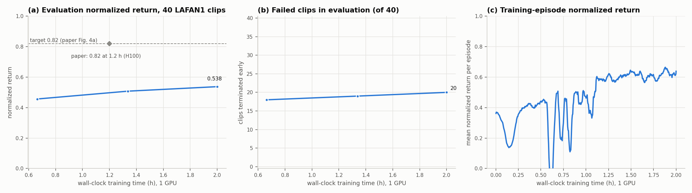
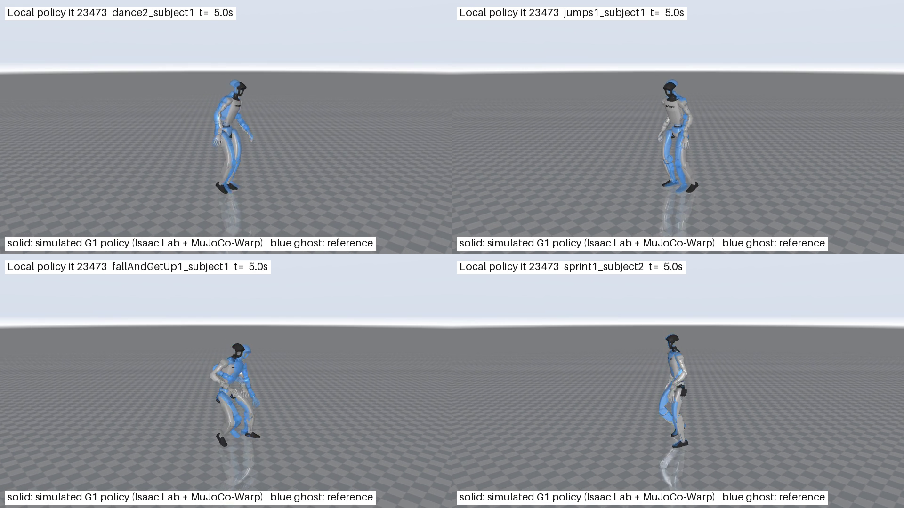

# Local reproduction results

Best evaluated checkpoint: `logs/local_3060/ckpt_023473.pt` (resume training with `logs/local_3060/last.pt`).

Evaluation return: **0.5376**; failed clips: **20/40**.

README target: return >= 0.82 and 0/40 failures. Target reached: **False**.

Actual configuration and all per-clip returns are in [summary.json](summary.json). The video shows the simulated trained policy and the blue reference ghost. Terminated clips are marked in the video.

## 验证记录

本次在 RTX 3060 Laptop（6 GB）上使用小批量配置，正式训练到第 23,473 次迭代。
两小时训练预算已使用完；**完整的 README 指标及跟踪质量尚未复现**。

- 40 段动作、264,705 个原始帧和 38 个网格校验通过；数据版本记录在 `data/source.json`。
- 机器人状态往返误差最大约 1.5e-8；FK 位置误差约 6e-7 米，位置、旋转矩阵及速度断言通过。
- 两项回放缓冲区回归测试通过；短程训练 5 次迭代后恢复到 7，时限退出测试正确保存第 8 次迭代。
- 正式训练最终日志、三个模型的权重和优化器恢复状态校验通过，最终保存也发生在非定期检查点迭代。
- 三个检查点各评估全部 40 段动作；汇总与逐段指标一致，40 段记录轨迹的关节和根位置均为有限值。
- MP4：40 秒、960×540、H.264、1000 帧；GIF：40 秒、640×360、480 帧。已检查舞蹈、跳跃、起身、冲刺的实际画面。
- 所有项目依赖安装在 Docker 内。完整执行记录、环境版本和恢复权重保存在 `logs/local_3060/`。

失败动作列在 [summary.json](summary.json)；视频只展示各选定动作的前 10 秒，不能代替完整片段评估。

