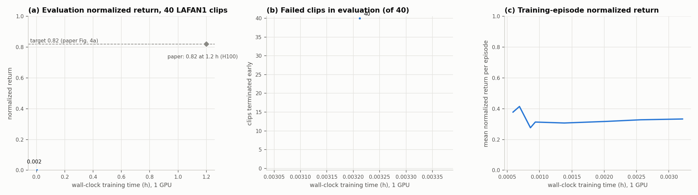
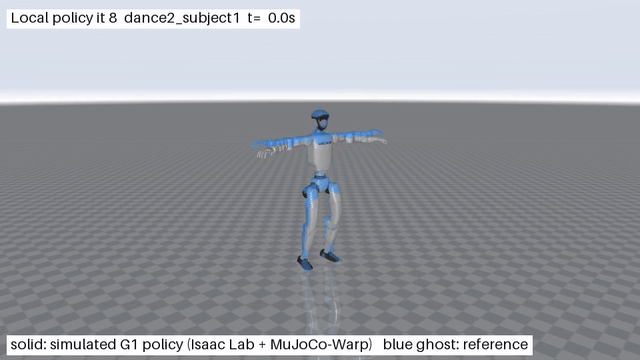

# Local reproduction results

Best evaluated checkpoint: `logs/local_3060_smoke/ckpt_000008.pt` (resume training with `logs/local_3060_smoke/last.pt`).

Evaluation return: **0.0017**; failed clips: **40/40**.

README target: return >= 0.82 and 0/40 failures. Target reached: **False**.

Actual configuration and all per-clip returns are in [summary.json](summary.json). The video shows the simulated trained policy and the blue reference ghost. Terminated clips are marked in the video.

