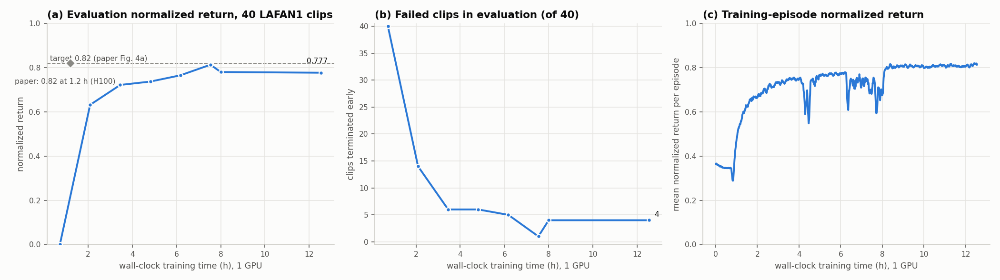

# Local reproduction results

Selected checkpoint: `logs/local_3060_v2/ckpt_048000.pt`; resume training with `logs/local_3060_v2/last.pt`.

Evaluation return: **0.8162**; failed clips: **0/40**.

Target (return >= 0.82, 0/40 failures, three fresh evaluations) reached: **False**.

Highest return: `logs/local_3060_v2/ckpt_048000.pt`; fewest failures: `logs/local_3060_v2/ckpt_048000.pt`.

[summary.json](summary.json) contains the selected checkpoint's configuration, per-clip diagnostics, confirmation evaluations and complete stage evaluation history.

训练已按用户要求停止于第 **75,614** 次迭代，累计训练 **12.54 小时**。

最终导出使用第 48,000 次迭代权重，本次复评平均回报 **0.8162**，失败 **0/40**。历史评分保留在日志目录 `eval.csv`，各次评估可能有波动。

已按用户当前验收要求保留结果。最佳模型、最终模型和含优化器状态的恢复点见 [weights/README.md](weights/README.md)，校验清单见 [weights/manifest.json](weights/manifest.json)。
